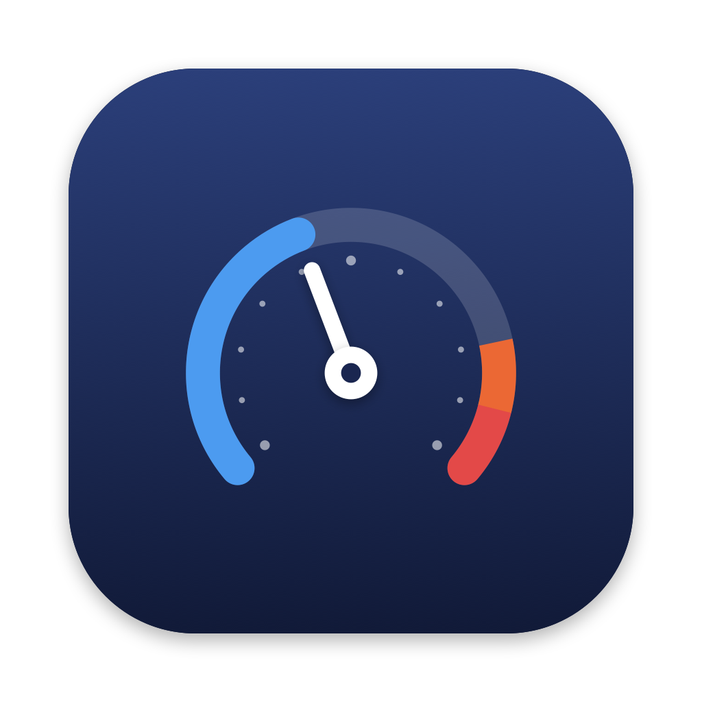
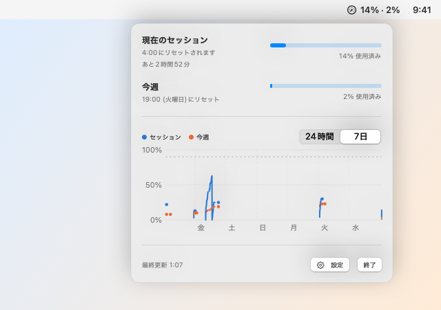
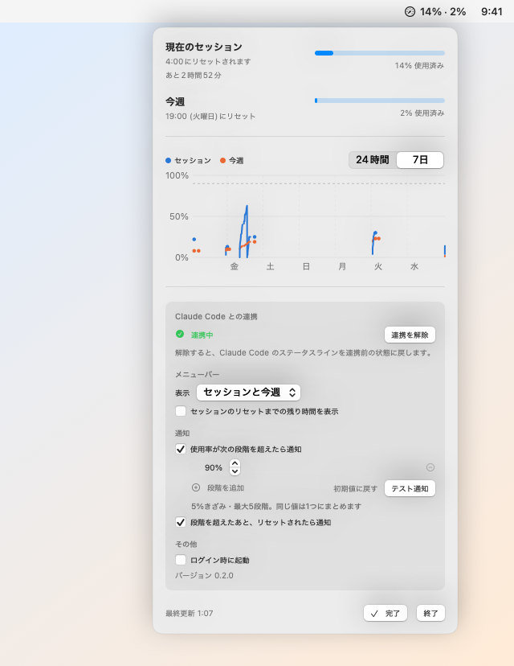

# Headroom



Claude Code の使用量（現在のセッション / 今週）を、Mac のメニューバーに常に表示するアプリです。
Claude Code の公式機能「[ステータスライン](https://code.claude.com/docs/en/statusline)」と連携して動きます。

**[ダウンロード（最新版）](../../releases/latest)** ・ macOS 14 以降 ・ Apple シリコン / Intel 両対応 ・ 無料

<picture>
  <source media="(prefers-color-scheme: dark)" srcset="docs/images/menu-dark.png">
  
</picture>

## できること

- メニューバーに `14% · 2%` のように使用率を表示（セッションだけ・今週だけ・アイコンだけにも切り替え可）
- 使用率が設定した段階（初期値 80% / 90%）を超えたら通知
- 上限近くまで使ったあと、リセットされたらお知らせ
- 使用率の履歴グラフ（24時間 / 7日）

## 使える人

- **Claude Code を Pro / Max プランで使っている人**
- ブラウザの claude.ai やデスクトップアプリ（チャット）だけを使っている場合は利用できません
- Claude Code を API キーで使っている場合も利用できません（プランの使用量がないため）

## インストール

1. [Releases](../../releases/latest) から `Headroom-x.x.x.dmg` をダウンロードして開く
2. 「Headroom」を「アプリケーション」フォルダにドラッグ
3. アプリケーションフォルダから Headroom を開く。Dock には出ず、メニューバーにメーターのアイコンが出ます

### 「開けません」と表示されたら

Apple の公証を受けていないため、初回だけ次の操作が必要です。

1. 警告が出たら「完了」（または「OK」）を押して閉じる
2. システム設定 > プライバシーとセキュリティ を開く
3. 下のほうにある「"Headroom"は…」の横の **「このまま開く」** を押す
4. パスワードを入力し、もう一度「開く」を押す

## Claude Code と連携する（最初に1回だけ）

1. メニューバーのアイコンをクリックし、**「Claude Code と連携する」** を押す
2. Claude Code を起動中なら、一度終了して起動し直す
3. Claude Code で何か送ると、使用量が表示されます

連携すると、Claude Code の設定ファイル（`~/.claude/settings.json`）にステータスラインが追加されます。

- 元の設定ファイルは `~/.claude/settings.json.headroom-backup` にバックアップします
- ほかの設定（モデルや権限など）はそのまま残します
- すでに自分でステータスラインを設定している場合も、その表示はそのまま残ります
- 設定（⚙）の **「連携を解除」** で元の状態に戻せます
- プロジェクトごとの設定（`.claude/settings.json`）でステータスラインを設定しているフォルダでは、そちらが優先されるため更新されません

## 設定

メニューの「⚙ 設定」から変更できます。

<picture>
  <source media="(prefers-color-scheme: dark)" srcset="docs/images/settings-dark.png">
  
</picture>

- メニューバーの表示（セッションと今週 / セッションのみ / 今週のみ / アイコンのみ）と、残り時間の表示
- 通知のオン・オフ、通知する段階（5% 刻み、最大5つ）、リセットのお知らせ
- ログイン時に起動

## 更新のタイミング

- Claude Code が返答するたびに更新されます
- Claude Code を使っていない間は更新されません（最後の値と、何分前の値かを表示します）
- claude.ai のチャットで使った分は、次に Claude Code を使ったときに反映されます

## データの扱い

- Claude Code がステータスラインに渡す情報のうち、**使用量（使用率とリセット時刻）だけ** を `~/Library/Application Support/Headroom` に保存します
- 会話の内容、作業フォルダの場所、ログイン情報は保存しません
- **ログイン情報には触れず、インターネットにも一切接続しません**

## アンインストール

1. 設定（⚙）>「連携を解除」を押す（Claude Code の設定を元に戻します）
2. メニューバーのアイコン >「終了」
3. アプリケーションフォルダから Headroom をゴミ箱へ
4. 履歴も消す場合は `~/Library/Application Support/Headroom` を削除

## 仕組み

```
Claude Code ──(ステータスラインに JSON を渡す)──▶ statusline.sh
                                                  │ rate_limits だけを取り出して
                                                  │ セッションごとに保存
                                                  ▼
             ~/Library/Application Support/Headroom/sessions/*.json
                                                  │ 5秒ごとに更新を確認し、
                                                  │ 全セッションから最新の値を選ぶ
                                                  ▼
                                          Headroom（メニューバー）
```

- スクリプトは macOS 標準の `plutil` だけを使います（`jq` 不要）
- 複数の Claude Code を同時に使っていても、放置中のセッションの古い値に引きずられないよう、リセット時刻が新しい値・同じなら使用率が高い値を選びます

## 開発

```bash
./build.sh          # build/Headroom.app
./build.sh dist     # dist/ に dmg と zip
swift test          # テスト
```

Developer ID で署名・公証する場合:

```bash
xcrun notarytool store-credentials <プロファイル名>   # 最初に1回
DEVELOPER_ID="Developer ID Application: 名前 (TEAMID)" NOTARY_PROFILE=<プロファイル名> ./build.sh dist
```

アイコンは `Icon/make_icon.swift` で描画し、`Icon/AppIcon.icon`（Icon Composer 形式）を `build.sh` が `actool` で変換して組み込みます。

```bash
swift Icon/make_icon.swift
```

## 注意

- Anthropic の公式アプリではありません
- Claude Code の仕様が変わると、表示できなくなる可能性があります

## ライセンス

[MIT](LICENSE)
